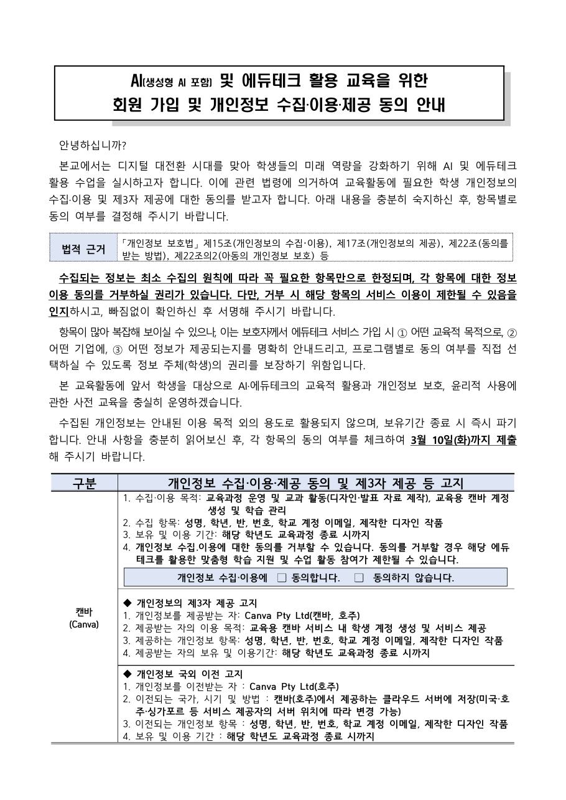

# 에듀테크 개인정보 동의서 생성기 (Claude Code 스킬)

수업에 쓰는 에듀테크(캔바, 패들렛, 구글 워크스페이스, 클래스팅, 띵커벨, 엔트리, 미리캔버스, 똑똑! 수학탐험대 …)의
개인정보처리방침을 찾아 읽고, 학부모에게 보내는 「개인정보 수집·이용·제공 동의서」를 만듭니다.
양식은 서울시교육청이 2026년 3월 5일 배포한 예시 양식을 그대로 씁니다.

학습지원 소프트웨어 학운위 심의(에듀집 체크리스트)와는 별개 절차입니다. 심의를 받았더라도
학생 개인정보를 수집하는 서비스는 보호자 동의가 따로 필요합니다(개인정보보호법 제15·17·22·22조의2, 국외이전 제28조의8).

## 무엇이 나오나

| 산출물 | 용도 |
|---|---|
| `동의서_….hwpx` | 배부용 가정통신문 완성본. 제품마다 [수집·이용 동의 + 체크박스] [제3자 제공 고지] [해외 서비스면 국외이전 고지] 블록, 서명란까지 |
| `동의서표_….html` | 표만 담은 클릭 복사판. 학교 자체 양식에 붙일 때. 제품 칸을 누르면 블록이 복사되고, "표 전체 복사"는 한글·워드에 표로 붙습니다. 인터넷 연결 없이 열립니다 |
| `근거표_….md` | 교사 검토용. 동의서에 적은 값과 약관 원문 문장을 나란히 보여 줍니다 |

약관에 없는 내용은 지어내지 않고 **[확인 필요]**로 표시합니다(HTML에서는 노란색).



## 설치 (Claude Code · Codex)

AI에게 이렇게 말하면 됩니다.

> 이 저장소를 스킬로 설치해줘: https://github.com/starrylifee/edutech-privacy-consent

직접 하려면 저장소 폴더를 통째로 스킬 폴더에 넣습니다.

| 프로그램 | 위치 |
|---|---|
| Claude Code | `~/.claude/skills/edutech-privacy-consent/` |
| Codex (CLI·IDE 확장) | `~/.agents/skills/edutech-privacy-consent/` |

```bash
git clone https://github.com/starrylifee/edutech-privacy-consent ~/.claude/skills/edutech-privacy-consent
```

윈도우라면 `~`는 `C:\Users\내이름`입니다. 넣은 뒤 프로그램을 한 번 껐다 켜세요.
필요한 것은 파이썬 3뿐입니다(표준 라이브러리만 씀). 한글 파일을 열어 화면까지 확인하려면 한글이 설치된 윈도우에서 `pip install pywin32 pymupdf`를 추가하세요(선택).
외부 AI API나 별도 모델은 쓰지 않습니다. 약관 읽기·추출은 스킬을 실행하는 AI가 직접 합니다.

## 쓰는 법

Claude Code에서:

> 캔바, 패들렛, 똑똑수학탐험대 동의서 만들어줘. 학교는 ○○초, 3월 10일까지.

AI가 제품 DB에 없는 서비스는 약관을 찾아 읽고(curl → 도움말센터 API → 크롬 → 앱스토어 약관 링크 순), 10개 항목을 근거 문장과 함께 뽑은 뒤 hwpx·HTML·근거표를 만들어 줍니다.

AI 없이 직접 돌리려면:

```
python scripts/build_consent.py data/example.json -o out/동의서_예시.hwpx
python scripts/build_html.py    data/example.json -o out/동의서표_예시.html
python scripts/make_review.py   data/example.json -o out/근거표_예시.md
python scripts/render_check.py  out/동의서_예시.hwpx 110   # 한글로 열어 PDF/PNG 확인(선택)
```

설정 파일(`data/example.json`):

```json
{
  "school": "○○초등학교",
  "deadline": "3월 10일(화)",
  "date": "2026. 3. 3.",
  "product_files": ["products/canva.json", "products/padlet.json", "products/toctocmath.json"]
}
```

8종을 한 번에 넣은 예는 `data/all8.json`입니다.

## 제품 DB (data/products)

| 파일 | 서비스 | 약관 확인일 | 비고 |
|---|---|---|---|
| canva | 캔바 | 2026-10-19 | 해외(호주), 국외이전 고지 |
| padlet | 패들렛 | 2026-10-19 | 해외(미국), 국외이전 고지 |
| google_workspace_edu | 구글 워크스페이스 for Education | 2026-10-19 | 해외(미국). 고지에 보유기간·서버 위치 없음 |
| miricanvas | 미리캔버스 | 2026-10-19 | 국내 회사, 봇 검증·고객 문의 일부 국외 위탁 |
| classting | 클래스팅 | 2026-10-19 | 국내 회사, AI 보조교사 대화가 OpenAI(미국)로 감 |
| iscream_tkbell | 띵커벨(아이스크림) | 2026-10-19 | 국내 |
| entry | 엔트리 | 2026-10-19 | 국내. 약관이 2023년판이라 재확인 권장 |
| toctocmath | 똑똑! 수학탐험대 | 2026-10-19 | 국내 공공(KERIS) |
| quizn | 퀴즈앤 | 2026-10-19 | 국내. 학생은 회원 가입 없이 참여 코드·닉네임으로 참여(약관은 영문판) |

## 새 제품 추가

1. 개인정보처리방침 본문을 텍스트로 저장: `python scripts/html2text.py URL data/policies/제품_개인정보처리방침_날짜.txt`
   (본문이 안 받아지면 WebFetch, 크롬, 앱스토어 페이지의 약관 링크, 도움말센터 API 순으로 시도. 자세한 순서는 SKILL.md 2단계)
2. 추출: AI가 `references/extraction-guide.md`대로 약관을 읽고 `data/products/제품.json`을 씁니다(빈 틀 `data/products/_template.json`). 10개 항목마다 약관 원문 근거 문장을 함께 남깁니다.
3. 상단 필드(동의서에 찍히는 값)를 학부모가 읽기 쉽게 다듬습니다. 규칙은 같은 파일에 있습니다(학생 계정 항목만, 국외이전 넣는 조건 4가지, 모르면 [확인 필요]).
4. 설정 파일의 `product_files`에 추가하고 다시 생성합니다.

제품 JSON 필드:

| 필드 | 뜻 |
|---|---|
| `name` | 동의서 왼쪽 칸 제품명. 7자 안팎으로 `"패들렛\n(Padlet)"`처럼 줄을 나눕니다 |
| `foreign`, `country` | 해외 서비스 여부와 국가. `true`면 국외이전 고지 블록이 붙습니다 |
| `items`, `purpose`, `retention` | 수집항목·목적·보유기간(학부모가 읽는 글) |
| `third_party` | 제공받는 자·목적·항목·기간 |
| `transfer` | 국외이전: 이전받는 자·국가와 방법·항목·기간 |
| `_extracted` | 약관에서 뽑은 10개 항목과 근거 문장(근거표에 쓰임) |
| `_source` | 약관 URL, 시행일, 확인일, 방법 |

## 주의

- 약관 해석은 AI가 돕지만 **배부 전 교사가 근거표로 대조**해야 합니다. 법적 책임은 학교에 있습니다.
- 약관은 수시로 바뀝니다. `_source.policy_version`과 확인일이 오래됐으면 다시 확인하세요.
- 해외 서비스(캔바·패들렛)는 봇 차단 때문에 약관을 자동으로 못 받을 수 있습니다. 브라우저로 열어 본문을 복사해 저장하면 됩니다.

## 구조

```
SKILL.md        AI가 읽는 작업 순서(이 폴더가 곧 스킬)
template/       서울시교육청 동의서 양식(hwpx)
scripts/        build_consent.py(hwpx) · build_html.py(클릭 복사 표) · make_review.py(근거표)
                html2text.py(약관 받기) · render_check.py(한글 렌더 확인, 선택)
references/     extraction-guide.md(AI가 약관에서 뽑는 10개 항목과 작성 규칙)
data/           example.json · all8.json(설정) · products/(제품별 JSON, _template.json) · policies/(약관 원문)
out/            생성물   docs/  예시 화면
```

양식 출처: 서울시교육청 창의미래교육과 「(서식) 개인정보 수집이용제공 동의 안내 양식(예시)」 2026.3.5.
같은 주제의 다른 접근(약관 붙여 넣기 → 표 HTML/hwpx): [Ingyu87/edu-consent-form](https://github.com/Ingyu87/edu-consent-form). 클릭 복사 표와 [확인 필요] 표시는 그 아이디어를 참고했습니다.
